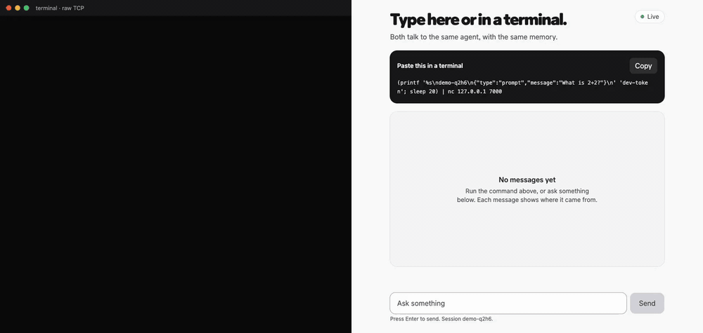

# pi-tcp

One durable Pi session with two doors: raw TCP and a web page.



Left: `nc` to port 7000. Right: the web page. One agent, one memory. [MP4](media/demo.mp4) · 14 s · recorded live with `npm run record-demo` (needs `npm run dev`).

```
nc ─────────▶ Worker connect() ─┐
                                ├─▶ PiSession Durable Object ─▶ Pi Durable harness (SQLite)
browser ─ws─▶ Worker fetch() ───┘         fans each new entry out to every peer
```

Ask from `nc` and the turn shows up in the browser, tagged `nc`. Ask from the browser and `nc` prints it. Drop either side, reconnect, send `replay`, and you get the turns you missed.

This is a **proof** of [inbound TCP for Workers](https://developers.cloudflare.com/changelog/post/2026-11-19-inbound-tcp/) (public beta) and [`@earendil-works/pi-durable`](https://www.npmjs.com/package/@earendil-works/pi-durable). It is not a product. It has one shared token, no TLS and no accounts.

It also runs in production: a Spectrum app with a Worker origin sends `tcp/7000` on a Cloudflare zone to this Worker, and a prompt over the public internet was answered in 1.2 s. The public endpoint needs the token; its web page sits behind Cloudflare Access.

## Status

[`status.json`](status.json) holds the claim and its last result:

> One Pi Durable session takes turns from raw TCP and from a browser at the same time; each side sees the other's turns; a reconnect on either side loses no turns.

**Proven locally** (`wrangler dev`). **Not proven** over the public internet, because that needs Spectrum on a paid zone. Refer to [`receipts/findings.md`](receipts/findings.md).

## Run it

```sh
npm install
npm run dev
```

Open http://localhost:8791/?token=dev-token&session=demo. Then, in a second terminal:

```sh
PI_TCP_TOKEN=dev-token node bin/pi-tcp.mjs 127.0.0.1:7000 demo
```

Or use plain `nc`:

```sh
(printf 'dev-token\ndemo\n{"type":"prompt","message":"hi from nc"}\n'; sleep 20) | nc 127.0.0.1 7000
```

The `AI` binding always calls Workers AI remotely, so prompts cost a little, even in local dev.

## Prove it

With `npm run dev` running:

```sh
npm run proof
```

This opens one TCP peer and one WebSocket peer on a new session. It runs 10 checks:

- a turn in each direction
- a reconnect with replay on each side
- history order

It then writes `receipts/proof-<date>.md` and `status.json`. It exits non-zero if any check fails.

## Protocol

The protocol is newline-delimited JSON, and both doors use the same frames. On TCP:

1. Send the token on the first line.
2. Send the session name (`[a-z0-9-]{1,63}`) on the second line.

The browser connects to `/ws/<session>?token=…` instead.

| Command | Reply |
|---|---|
| `{"type":"prompt","message":"..."}` | `response`, then `busy` and `entry` frames to every peer, then `agent_settled` |
| `{"type":"get_messages","id":"1"}` | `response` with every entry |
| `{"type":"replay","after":15,"id":"2"}` | `response` with entries after id 15 |
| `{"type":"abort"}` | stops the current turn |

Server frames: `ready`, `peers` (`{tcp, web}` counts), `entry` (`{id, kind, text, via?}`), `busy` (`{via}`), `agent_settled`, `response` and `refused`. Types are in [`src/protocol.ts`](src/protocol.ts).

## Layout

| Path | What |
|---|---|
| `src/index.ts` | Worker. `connect()` checks the token and session, then pipes to the Durable Object. `fetch()` serves `/ws/:session` and the static client. |
| `src/agent.ts` | `PiSession` Durable Object. Holds the harness and the peer set, and broadcasts entries. |
| `src/protocol.ts` | Shared Effect Schema types for commands and frames. |
| `client/` | Foldkit + Tailwind page. Built into `public/` by `npm run build`. |
| `bin/pi-tcp.mjs` | Terminal client. |
| `scripts/proof.mjs` | End-to-end proof that writes a receipt. |

## What this does not do

- **No TLS.** The token and prompts cross the network in plain text.
- **No streaming tokens.** Peers get each entry after it is written.
- **No tools.** The agent has only the model.
- **No public endpoint.** The Worker is deployed with `workers_dev` off. Public TCP needs a Spectrum app on a Pro zone.

MIT
